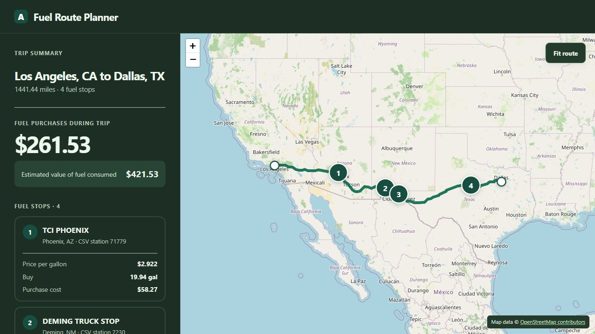
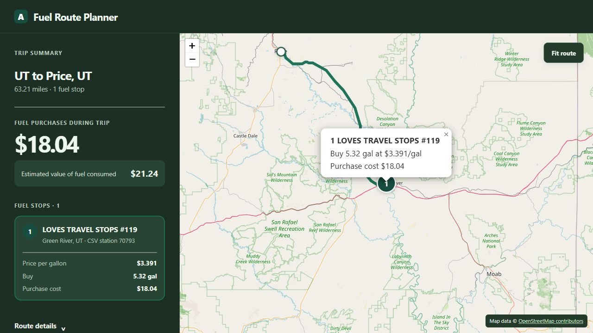

# Fuel Route Planner

**Plan your best trip. Fuel smarter on the road.**

A Django API that plans US road trips with fuel stops, purchase quantities,
clear costs, and an interactive map. It combines the supplied station-price CSV
with road routing and verifies the selected route before returning a plan.



## Features

- Start and finish with coordinates, city/state, or a prepared place ID.
- Find fuel stops and calculate how many gallons to buy at each one.
- Choose balanced planning or spend more time improving fuel cost.
- Respect fuel reserves and the extra-driving allowance.
- View purchase costs, fuel consumed, route geometry, and stop details.
- Retrieve saved trips and maps for 24 hours.

The vehicle model uses a 50-gallon tank and 10 miles per US gallon.
The prepared snapshot contains 6,626 US offers and 6,394 road points.
Prices come from the supplied CSV snapshot rather than a live price feed.



## Run locally

Install [uv](https://docs.astral.sh/uv/getting-started/installation/) and ensure
`curl` is on PATH. uv installs Python 3.13. Windows includes `curl.exe`;
Debian/Ubuntu users can install `curl` and `ca-certificates` through apt.

Clone this repository, then download `assets.zip` from the
[latest release](https://github.com/SergioDevUni/fuel-route-planner-public/releases/latest).
The complete release ZIP includes both source and prepared data.

```sh
git clone https://github.com/SergioDevUni/fuel-route-planner-public.git
cd fuel-route-planner-public
uv run --locked --no-dev python -m scripts.setup_local --bundle /path/to/assets.zip
```

Replace `/path/to/assets.zip` with the downloaded file. For the complete release
ZIP, use `var/container-assets/assets.zip` from its extracted project directory.
Setup verifies data hashes, prepares SQLite and map assets, and creates `.env`.

Set `ORS_API_KEY` in `.env` to your [openrouteservice key](https://account.heigit.org/),
then start the API:

```sh
uv run --locked --no-dev python -m scripts.start_local
```

Open [API readiness](http://127.0.0.1:8000/health/ready). Stop with Ctrl+C.
Live routing and map tiles require internet access.

### Docker

The complete release ZIP includes the data under `var/container-assets/`.
For a Git clone, place `assets.zip` there and copy `local-release.json` into the
same directory. Create `.env` from `.env.example`, set your `ORS_API_KEY`, and
set `DJANGO_SECRET_KEY` to a private random value. Local setup generates that
secret automatically, or generate one with
`uv run --locked --no-dev python -c "import secrets; print(secrets.token_urlsafe(48))"`.

With Docker and Compose running:

```sh
docker compose up --build -d
```

Use the same readiness URL. `docker compose down` stops the service; named
volumes preserve installed data and saved results. The production override
requires your public hosts and the exact address of your HTTPS reverse proxy.

## Try the API

Send this JSON to `POST http://127.0.0.1:8000/api/v1/trips`:

```json
{
  "start": {"type": "coordinates", "latitude": 38.995, "longitude": -110.17},
  "finish": {"type": "city", "city": "Price", "state": "UT"},
  "initial_fuel_gallons": "1",
  "initial_fuel_price_per_gallon": "3.20"
}
```

Read `fuel_stops` for station prices and purchased gallons, and
`costs.fuel_purchases_cost` for cash spent. Open `map_url` to explore the trip.
Retrieve saved JSON with `GET /api/v1/trips/{trip_id}` and
`Authorization: Bearer <result_token>`. Keep the token private.

Import the [Postman collection](docs/fuel-route-planner.postman_collection.json)
for runnable requests, or use the [OpenAPI specification](docs/openapi.yaml)
for the complete request and response schemas.

## How it works

Django validates requests and resolves locations from prepared data. Directed
road search compares station sequences under fuel and driving constraints.
The quantity optimizer recalculates purchases on the final verified road legs,
and a Decimal ledger separates cash purchases from the value of fuel consumed.
SQLite stores saved trips; Leaflet displays their routes and fuel stops.

The default setup uses hosted openrouteservice routing. The bundled road
checkpoint has 4,231 completed sources; optional local Valhalla tiles are a
separate dependency. Search is bounded by available road data and request time,
so results do not establish an absolute nationwide minimum fuel cost.

## Performance

Prepared station data, routing caches, and shared work for identical requests
reduce repeated computation. Balanced planning uses a 10-second preferred
window within a 15-second hard request budget.

A recorded live-routing benchmark on October 13, 2026 used an earlier development
build on Windows with 12 logical CPUs, 32 Waitress threads, and prepared data
already loaded. Across 126 trip requests, it returned 120 verified plans,
six expected low-fuel rejections, and no unexpected failures.

| Routing/cache state | Sequential p95 | Six concurrent requests p95 |
| --- | ---: | ---: |
| Cold routing cache | 6.824 s | 9.152 s |
| Warm routing cache | 4.731 s | 6.984 s |
| Cached verified result | 0.102 s | 0.528 s |

p95 is the 95th-percentile response time for successful plans. Sequential results
cover a mix of trip lengths; concurrent results cover six long-trip cases.
Cold routing means empty routing caches, with the process and data already
initialized. These are recorded sample results; network and routing-provider
latency affect actual response times.

## Tests

```sh
uv sync --locked
uv run --locked pytest -q
uv run --locked python manage.py test
```

CI runs tests and static checks on Windows and Linux, plus Docker verification
on Linux.

## Data credits

Fuel offers come from the supplied assessment CSV. Reviewed station coordinates
and source classifications are recorded in the
[station review data](data/review/us_station_manual_review.json).
Locations use [GeoNames](https://www.geonames.org/) (CC BY 4.0),
[US Census Bureau](https://www2.census.gov/geo/tiger/GENZ2023/shp/),
[Overture Maps](https://docs.overturemaps.org/attribution/),
[OpenInterstate](https://openinterstate.org/schema/), and public facility/operator
records. Map data © [OpenStreetMap contributors](https://www.openstreetmap.org/copyright).
[openrouteservice](https://openrouteservice.org/) supplies hosted routing;
[Leaflet](https://leafletjs.com/) supplies map display and retains its bundled
copyright notices.
